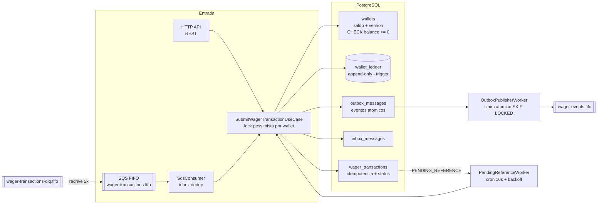

# 🦧 Jungle Gaming — Distributed Wagering Processor

> Processador financeiro distribuído de apostas (BET · WIN · LOSS · REFUND · ROLLBACK)
> com idempotência persistente, concorrência por wallet e ledger auditável.
> **Bun · NestJS · PostgreSQL · SQS (LocalStack) · MikroORM**

[](https://github.com/Caio13Vinni/wagering-processor/actions/workflows/ci.yml)


---

## 🧠 Arquitetura

### ▶️ Diagrama animado — a história de uma aposta


Fluxo completo em 8 passos: envio da aposta → idempotência + lock pessimista → commit atômico →
replay com saldo original → corrida de saldo (2× BET 80) → evento do outbox → REFUND fora de
ordem resolvido pelo worker de `PENDING_REFERENCE`.




**Invariantes no schema** (não só no código): `CHECK (balance >= 0)` · ledger imutável via trigger ·
≤ 1 lançamento por transação · reversão única por tipo (índice único parcial) · FKs deferrables.

## 🚀 Quickstart

```bash
git clone https://github.com/Caio13Vinni/wagering-processor && cd wagering-processor
bun install

docker compose up -d --wait          # postgres + localstack + keycloak
bun run migration:up                 # schema consolidado (1 migration)
bun run setup:queues                 # filas (idempotente)
bun run start                        # API :3000 + consumer + workers
```

Ou full-container: `docker compose up -d --wait` (o `app` roda migrations ao subir).

```bash
curl localhost:3000/health/ready
# {"status":"ready","checks":{"database":"up","sqs":"up"}}
```

## 🔁 Garantias (o que o sistema sobrevive)

| Cenário | Garantia |
|---|---|
| Mesma mensagem/redelivery N× | inbox persistente + idempotency-key → replay com o **saldo original** |
| Corrida na idempotency-key | unique constraint decide; 3 desfechos: replay / **409** / 503 transitório |
| 50 apostas paralelas, mesma key | exatamente **1 débito** (testado) |
| Duas apostas disputando o saldo | lock pessimista por wallet + version + `CHECK balance >= 0` |
| REFUND chega antes da BET | `PENDING_REFERENCE` → worker resolve sozinho em ~15s |
| Referência rejeitada pelo provedor | rejeição **imediata** (`REFERENCE_NOT_PROCESSED`), sem esperar backoff |
| Processo morre pós-commit | outbox + visibility timeout — nada perdido, nada duplicado |
| SQL manual malicioso | ledger **append-only por trigger** — nem UPDATE passa |

## 📊 Qualidade

| Verificação | Resultado |
|---|---|
| Testes (`bun test`) | **27/27** — unit + integração real + concorrência real |
| Typecheck strict | `tsc --noEmit` ✅ (job do CI) |
| CI | 4 jobs: quality · test (Postgres real) · docker build · smoke (stack no ar) |
| Carga (`bun run test:load`) | 500 BETs · 25 concorrentes · **94 rps** · p50 136ms / p95 272ms · **0 erros** |
| Invariante pós-carga | `balance == Σ ledger` consistente |

## 🌐 API

| Endpoint | Descrição |
|---|---|
| `POST /wallets` | cria wallet (409 se duplicada; opening credit no ledger) |
| `GET /wallets/:id` · `GET /wallets/:id/ledger?cursor=&limit=` | consultas (cursor opaco estável) |
| `POST /wallets/:id/reconciliation` | saldo vs Σ ledger — **nunca corrige silenciosamente** |
| `POST /wagering/transactions` | submete operação — header `Idempotency-Key` obrigatório |
| `GET /wagering/transactions/:id` · `GET /providers/:p/wagering/transactions/:ext` | consultas |
| `GET /health/live` · `GET /health/ready` · `GET /metrics` | sem autenticação |

**Status HTTP:** `201` processado · `200` replay · `202` pendente · `400` payload ·
`409` conflito · `422` regra de negócio · `503` transitório.

## 🔐 Autenticação (ponto de extensão)

Keycloak sobe com o realm `jungle` **auto-importado** (`keycloak/jungle-realm.json`):
client `wagering-api` (public), user `player1` / `senha123`, console `admin/admin`.

```bash
AUTH_ENABLED=true bun run start   # default false — guard JWT valida issuer + azp via JWKS
```

Health e metrics permanecem abertos por requisito do desafio.

## 🧪 Scripts

```bash
bun test                 # suíte completa (precisa do postgres no ar)
bun run test:load        # teste de carga + relatório (p50/p95/p99, throughput, invariante)
bun run migration:up     # aplica migrations
bun run setup:queues     # cria/atualiza filas (idempotente)
```

## 📚 Documentação

- [`ARCHITECTURE.md`](./ARCHITECTURE.md) — decisões, trade-offs, bugs encontrados em carga real e correções
- [`keycloak/jungle-realm.json`](./keycloak/jungle-realm.json) — realm auto-importado

## 🗂️ Estrutura

```
src/
├── application/        # use cases (execute + reprocess)
├── domain/             # money, wallet, ledger, transactions (@Check nas entities)
├── infrastructure/
│   ├── http/           # controllers + exception filter + DTOs
│   ├── sqs/            # consumer (inbox, ack pós-commit, DLQ, SIGTERM)
│   ├── metrics/        # contadores/gauges rotulados
│   └── auth/           # JwtAuthGuard (JWKS, azp) — flag AUTH_ENABLED
├── workers/            # outbox publisher (claim atômico) + pending-reference
└── config/             # env, mikro-orm (init manual — Bun), orm
docs/
├── fluxo-bet.brain      # diagrama de sequência (Brainagram) — fonte do GIF
└── fluxo-bet.gif        # diagrama animado do fluxo de uma aposta
test/
├── unit/               # Money
├── integration/        # regras de wagering, idempotência (Postgres real)
└── concurrency/        # hot wallet: 2×80 e 50× paralelo reais
```
